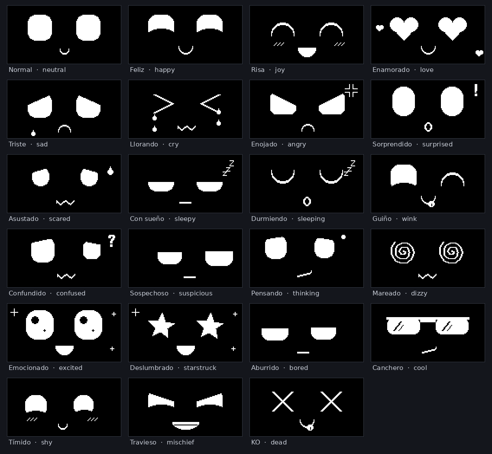

# Desk Companion – firmware propio

Firmware hecho desde cero para ESP32-C3 Super Mini + OLED 1.3" (SH1106) + sensor táctil TTP223.
Reemplaza por completo al firmware original.



## Conexiones (igual que tu imagen)

| Módulo | Pin | ESP32-C3 |
|---|---|---|
| OLED | SDA | GPIO 8 |
| OLED | SCL | GPIO 9 |
| OLED / Touch | VCC | 3.3V |
| OLED / Touch | GND | G |
| Touch | OUT | GPIO 7 |

Los pines se cambian en `DeskCompanion/config.h`. Si tu pantalla es una SSD1306 de 0.96" en vez de una SH1106, descomentá `USE_SSD1306`.

## Instalar sin instalar nada

**Primera vez (por USB, desde el navegador):** entrá a **https://jorgefinelli90.github.io/desk-companion/** con Chrome o Edge en la compu, conectá la placa y tocá *Instalar*.
Si no aparece el puerto: mantené **BOOT** apretado mientras enchufás la placa.
Otra opción: en [esptool-js](https://espressif.github.io/esptool-js/), cargar `factory.bin` en `0x0`.

**Actualizaciones (por WiFi):** bajá `ota.bin` de la misma página y subilo en **http://deskbuddy.local/ota** (usuario `admin`, clave `deskbuddy`, se cambian en `config.h`).
Se conservan la cara elegida, el WiFi y los ajustes.

**Cómo se compila:** con cada push a `main`, GitHub Actions compila con PlatformIO, arma `factory.bin` (bootloader + particiones + app) y `ota.bin`, y publica la página con los binarios. Para sacar una versión nueva, subí `FW_VERSION` en `DeskCompanion/config.h`, editá lo que quieras (se puede hacer desde la web de GitHub) y esperá unos 3 minutos.

<details><summary>Compilar en tu compu (opcional)</summary>

- Arduino IDE: placa *esp32 by Espressif*, librería **U8g2**, abrí `DeskCompanion/DeskCompanion.ino`, placa **ESP32C3 Dev Module** con *USB CDC On Boot: Enabled*.
- PlatformIO: `pio run -e esp32c3 -t upload`.
</details>

## Primer arranque (WiFi)

1. Sin WiFi guardado, la pantalla muestra **Configurar WiFi**.
2. Desde el celu, conectate a la red `DeskBuddy-XXXX` (clave `deskbuddy`).
3. Se abre el portal solo; si no, entrá a `http://192.168.4.1`.
4. En **Ajustes → Buscar redes**, elegí tu WiFi, poné la clave y tocá *Conectar y reiniciar*.
5. Desde ahí lo encontrás en **http://deskbuddy.local** o en la IP que muestra la pantalla.

> Aunque no tengas router, en modo AP también funciona todo: cualquiera que se conecte a `DeskBuddy-XXXX` puede mandarle mensajes.

## Uso

**Página web** (`http://deskbuddy.local`)
- Tocás una expresión y queda fija; se guarda aunque lo desenchufes.
- Mandar mensaje: nombre + texto (hasta 280 caracteres), con atajos rápidos y la opción de cambiar la cara junto con el mensaje.
- Historial con ✓ entregado / ✓✓ visto (pasa a *visto* cuando alguien toca el sensor).
- Ajustes: nombre, brillo, rotar la pantalla 180°, WiFi.

**Sensor táctil**
| Gesto | Acción |
|---|---|
| Tap | Con un mensaje en pantalla: lo marca como leído y pasa al siguiente. Sobre la cara: hace una reacción feliz durante 2.5 s |
| Doble tap | Pasa a la siguiente expresión |
| Mantener 1.5 s | Muestra IP / red |
| Mantener 10 s | Borra el WiFi (a partir de los 4 s aparece una cuenta regresiva; si soltás, se cancela) |

**Mensajes en pantalla**: primero aparece un sobre animado con "Mensaje de X". Si el texto es corto se ve en letra grande; si es largo, en letra chica con scroll automático. El mensaje queda en pantalla hasta que alguien lo toca, y si hay más arriba se indica con `+N`.
Se aceptan acentos, ñ, ¿ y ¡. Los emojis comunes se pasan a texto (❤️ → `<3`, 😊 → `:)`, 👍 → `(y)`).

## API (para scripts, atajos del celu, Home Assistant, etc.)

```bash
curl "http://deskbuddy.local/api/msg?from=Ana&text=Hola!"
curl "http://deskbuddy.local/api/msg?from=Bot&text=Deploy%20OK&expr=excited"
curl "http://deskbuddy.local/api/expr?id=sleepy"
curl "http://deskbuddy.local/api/state"
```

IDs de expresiones: `neutral happy joy love sad cry angry surprised scared sleepy sleeping wink confused suspicious thinking dizzy excited starstruck bored cool shy mischief dead`

## Agregar o modificar expresiones

Cada cara es una fila de la tabla `EXPRESSIONS` en `face.h`: tipo de ojo, tamaño, párpados (enojo/tristeza/sonrisa), hacia dónde mira, boca, animación y efectos (lágrimas, zzz, corazones, rubor, etc.). Si agregás una fila, aparece sola en la web.

## Notas
- Los mensajes se guardan en RAM (los últimos 12) y se pierden si se reinicia.
- Las Super Mini suelen tener problemas de WiFi por la antena; por eso viene activado `WIFI_LOW_TX_POWER`, que en la práctica mejora la conexión.
- En la Super Mini, el LED azul está en GPIO 8 (SDA), así que es normal que titile.
